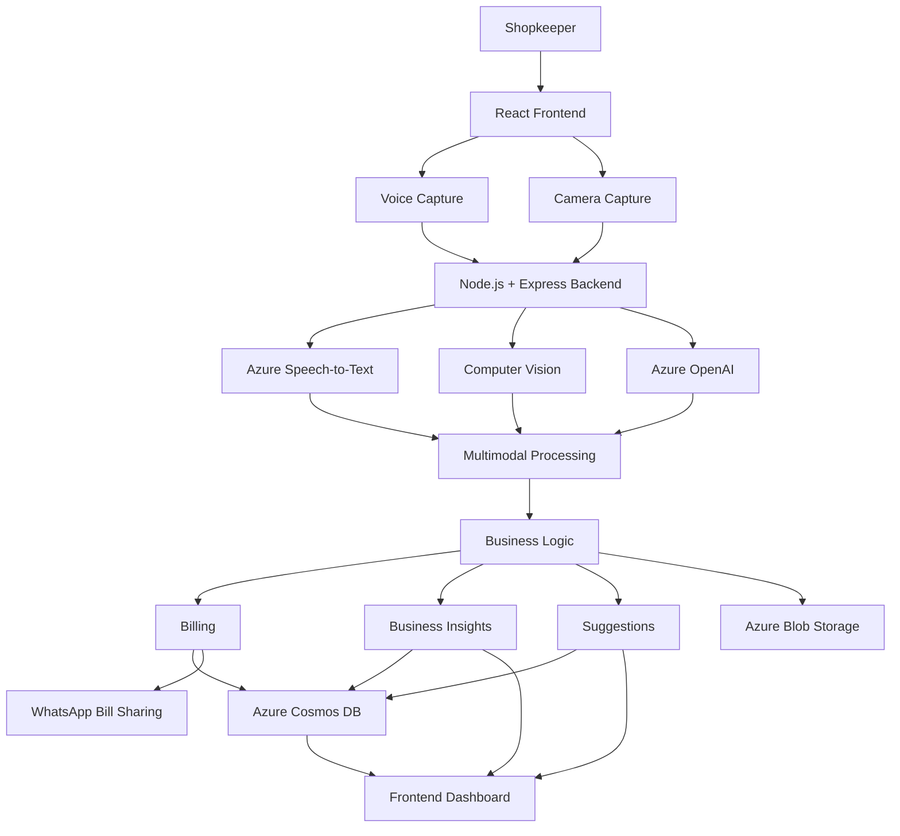

<div align="center">

# DataTalk AI

### Ambient Intelligence for Kirana Stores

**Turning everyday shop interactions into actionable business intelligence.**

Voice-first | Camera-powered | AI-driven

[Watch Demo](https://vimeo.com/1178296866)

</div>

---

## Overview

**DataTalk AI** is a voice-first, AI-powered business intelligence platform designed to help small retail businesses operate smarter without changing how they work.

Traditional kirana stores often rely on handwritten records, mental calculations, and intuition to manage sales and inventory. Existing digital solutions can introduce friction through manual data entry, complicated interfaces, and unfamiliar workflows.

DataTalk AI bridges this gap by introducing an ambient intelligence layer that understands shop activity through voice and camera input, converts real-world interactions into structured business data, and delivers useful insights.

> **Our vision:** Make every kirana store a self-aware, data-driven business without requiring shopkeepers to become technology experts.

---

## The Problem

Small retail businesses often operate without access to affordable, real-time business intelligence.

- **Manual bookkeeping:** Sales and transactions are frequently recorded on paper or remembered.
- **Limited visibility:** Understanding sales trends, profits, and business performance is difficult.
- **Inventory uncertainty:** Tracking products and identifying potential stock shortages can be challenging.
- **Time-consuming workflows:** Traditional digital tools often require repetitive typing and manual data entry.
- **Guesswork-driven decisions:** Shopkeepers lack structured data to make informed business decisions.

The result is a business environment where important decisions are made without reliable, actionable information.

## The Solution

DataTalk AI introduces an ambient intelligence layer that integrates naturally into everyday retail operations.

By combining voice input, camera input, and AI-powered processing, the system aims to reduce manual effort and make business information more accessible.

The platform supports the following workflows:

- **Voice interaction:** Capture spoken input and convert it into structured information.
- **Visual processing:** Use camera input and computer vision to provide visual context.
- **AI-assisted billing:** Process relevant information to support bill generation.
- **Business intelligence:** Generate insights and suggestions from available business data.
- **Bill sharing:** Enable bill sharing through WhatsApp links.

The underlying principle is simple: shopkeepers should be able to interact naturally with their stores instead of spending additional time managing software.

---

## Key Features

### Voice-First Interaction

Interact with the system through natural speech instead of navigating complicated forms.

- Capture spoken input through the browser's microphone.
- Convert speech into text using Azure Speech-to-Text.
- Process natural-language input to identify relevant information.
- Transform recognized information into structured data for downstream operations.

### Camera-Powered Product Recognition

Use camera input to provide visual context for retail interactions.

- Capture images using browser media APIs or an IP Webcam feed.
- Process visual input using computer vision capabilities.
- Extract relevant information to support product identification and billing workflows.

### AI-Assisted Billing

Convert supported voice and visual inputs into structured billing information.

- Reduce repetitive manual entry.
- Process recognized product and transaction details.
- Generate bills through the application workflow.
- Share bill links through WhatsApp.

### Business Intelligence

Turn structured business information into insights that can support everyday decisions.

- Understand recorded business activity.
- Identify potentially useful sales and inventory patterns.
- Generate AI-assisted suggestions.
- Present relevant information through an accessible interface.

### Cloud-Backed Data Management

Use cloud services to support data processing and persistence.

- Store structured application data in Azure Cosmos DB.
- Use Azure Blob Storage for supported file-storage workflows.
- Integrate AI services into the backend processing pipeline.

---

## System Architecture

DataTalk AI follows a modular architecture connecting frontend input capture, backend orchestration, AI processing, business logic, and persistent storage.



### How It Works

1. **Capture:** The frontend collects voice and camera input from the shopkeeper.
2. **Transmit:** The React application sends supported inputs to the Node.js backend.
3. **Process:** Azure AI services process speech, language, and visual information as required.
4. **Combine:** The backend coordinates the available information to build structured representations of shop activity.
5. **Execute:** Business logic processes the resulting data to support billing and business insights.
6. **Persist:** Relevant application data is stored in Azure Cosmos DB, with Azure Blob Storage available for supported file workflows.
7. **Present:** The frontend displays the resulting information, while bill-sharing workflows can use WhatsApp links.

---

## Technology Stack

| Layer | Technologies | Purpose |
|---|---|---|
| Frontend | React.js, TypeScript | Interactive user interface |
| Media Capture | Browser Media APIs | Microphone and camera input |
| Backend | Node.js, Express.js | API endpoints and application orchestration |
| Speech Processing | Azure Speech-to-Text | Speech recognition |
| Language Intelligence | Azure OpenAI | Natural-language processing and AI-assisted insights |
| Computer Vision | Azure Computer Vision | Visual input processing |
| Database | Azure Cosmos DB | Structured application data |
| File Storage | Azure Blob Storage | Supported file-storage workflows |
| Integrations | WhatsApp Deep Links | Bill-sharing workflow |
| Camera Integration | IP Webcam | Mobile camera feed integration |

---

## Core Workflow

```text
Shopkeeper
    |
    v
Voice Input + Camera Input
    |
    v
React Frontend
    |
    v
Node.js + Express Backend
    |
    v
Azure AI Services
    |
    v
Multimodal Processing
    |
    v
Business Logic
    |
    +------> Billing
    |
    +------> Business Insights
    |
    +------> Suggestions
    |
    v
Azure Cosmos DB
    |
    v
Frontend Output
    |
    v
WhatsApp Bill Sharing
```

---

## Getting Started

### Prerequisites

Ensure you have the following:

- Node.js and npm
- Access to the required Azure services
- Azure service credentials for the features you intend to run
- A modern browser with microphone and camera support

### Installation

**1. Clone the repository**

```bash
git clone git@github.com:YOUR_USERNAME/YOUR_REPOSITORY.git
cd YOUR_REPOSITORY
```

Replace `YOUR_USERNAME/YOUR_REPOSITORY` with your actual GitHub repository path.

**2. Install dependencies**

Run the following in the relevant frontend and backend directories, depending on the repository structure:

```bash
npm install
```

**3. Configure environment variables**

Create the required `.env` files based on the configuration expected by the application.

Typical configuration may include:

```env
AZURE_OPENAI_ENDPOINT=
AZURE_OPENAI_API_KEY=
AZURE_OPENAI_DEPLOYMENT=
AZURE_SPEECH_KEY=
AZURE_SPEECH_REGION=
AZURE_COSMOS_ENDPOINT=
AZURE_COSMOS_KEY=
AZURE_STORAGE_CONNECTION_STRING=
```

Only configure the variables required by your implementation.

Never commit API keys, connection strings, or other credentials to GitHub. Ensure `.env` files are included in `.gitignore`.

**4. Start the application**

Run the appropriate development commands for the frontend and backend.

For projects using separate frontend and backend directories, this typically means starting each application in a separate terminal:

```bash
npm run dev
```

The exact commands depend on the scripts defined in each directory's `package.json`.

**Note:** Update these instructions with the repository's actual directory structure, environment variable names, and startup commands before publishing.

---

## Demo

Watch the project demonstration:

**[DataTalk AI — Project Demo](https://vimeo.com/1178296866)**

The demo showcases the project's approach to combining voice interaction, visual input, AI processing, and business workflows for kirana stores.

---

## Future Scope

Potential future enhancements include:

- **Inventory forecasting:** Predict potential stock shortages using historical transaction data.
- **Sales analytics:** Provide daily, weekly, and monthly business summaries.
- **Profitability analysis:** Estimate margins using reliable purchase-cost and sales data.
- **Multilingual interaction:** Support regional languages commonly used by shopkeepers.
- **Low-connectivity support:** Explore workflows that remain usable during intermittent internet access.
- **Automated alerts:** Notify shopkeepers about important inventory or sales patterns.
- **Improved product recognition:** Strengthen visual recognition for products commonly found in kirana stores.

These are potential extensions rather than claims about features already implemented.

---

## Design Philosophy

DataTalk AI prioritizes real-world usability over unnecessary technical complexity.

Our approach emphasizes:

- **Natural interaction:** Minimize dependence on typing and complex interfaces.
- **Accessibility:** Make AI-assisted tools approachable for non-technical users.
- **Practical intelligence:** Focus on insights that can support actual business decisions.
- **Demo reliability:** Prioritize a dependable demonstration of the core workflows.
- **Modular architecture:** Keep the system extensible as new capabilities are introduced.

The goal is not to make shopkeepers adapt to technology. It is to make technology adapt to shopkeepers.

---

## Team

**RunTime Terror**

Built with a focus on making AI practical and accessible for small businesses.

---

<div align="center">

**DataTalk AI**

Making everyday retail smarter, one interaction at a time.

Built by RunTime Terror.

[Watch Demo](https://vimeo.com/1178296866)

</div>
